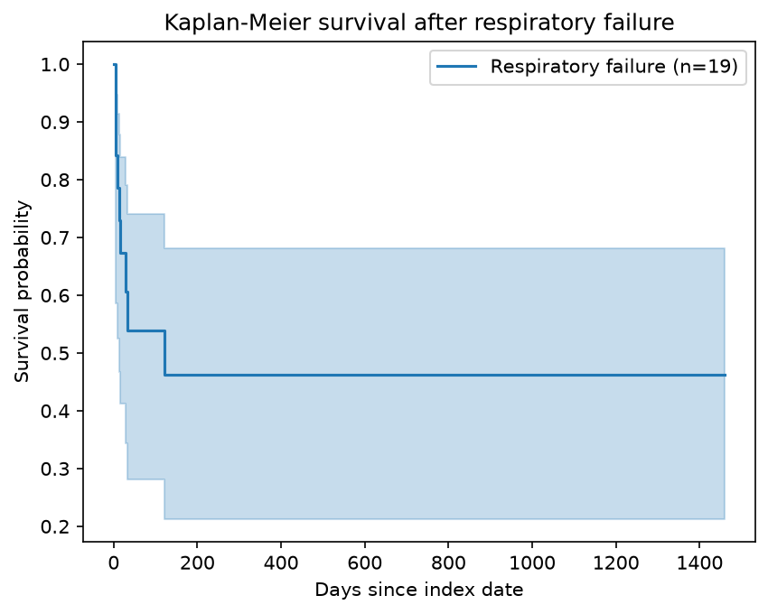

# Real-World Evidence on OMOP CDM

**Cohort analytics on MIMIC-IV demo data: from OMOP tables to a respiratory failure cohort, outcomes and survival analysis.**



## Overview

This project walks through a complete real-world data (RWD) analytics workflow on the **OMOP Common Data Model**, using SQL (DuckDB) and Python:

1. Explore and profile OMOP clinical tables
2. Define a **phenotype** (respiratory failure) and build a **cohort** with an index date
3. Derive **covariates** and **outcomes** (length of stay, in-hospital death, 30-day readmission)
4. Assess **data quality and missingness**
5. Run a **Kaplan-Meier survival analysis**
6. Document **biases and limitations**

It was built by a clinician (16 years in clinical practice) moving into health data science, to practise the workflow used in real-world evidence teams.

## Data

- **Source:** [MIMIC-IV demo data in the OMOP CDM, v0.9](https://physionet.org/content/mimic-iv-demo-omop/) (PhysioNet, Open Database License)
- **Population:** 100 de-identified ICU patients from Beth Israel Deaconess Medical Center
- **Format:** 32 OMOP CDM tables in CSV
- Data are **not included** in this repository. See *How to reproduce*.

## Methods

| Step | What was done | Techniques |
|---|---|---|
| Exploration | Loaded every OMOP table as a DuckDB view; profiled `person`, `visit_occurrence`, `measurement` | `GROUP BY`, data types, standard concept vs. source value |
| Joins | Visits per patient, age at first visit | `LEFT JOIN` vs. `INNER JOIN` |
| Advanced SQL | Visit sequences, days since previous discharge, 30-day readmissions | CTEs, window functions (`ROW_NUMBER`, `LAG`) |
| Phenotype | Respiratory failure: ICD-10 `J96*`, ICD-9 `51881`, `51882`, `51884` (excluding `51889`) | Source-code concept set |
| Cohort | First qualifying diagnosis per patient = index date; linked index visit | `ROW_NUMBER() ... WHERE rn = 1` |
| Analysis table | Age, sex, prior visits; length of stay, in-hospital death, 30-day readmission, time to death | Multiple CTEs, `CASE WHEN`, `COALESCE` |
| Data quality | Null percentages and distributions; structural vs. true missingness | `SUMMARIZE` |
| Survival | Time from index date to death, censored at end of observation | Kaplan-Meier (`lifelines`) |

## Key results (descriptive, n = 19)

| Measure | Value |
|---|---|
| Patients with respiratory failure | 19 of 100 |
| Mean age at index | 63.4 years |
| Median length of stay (index visit) | 9 days |
| In-hospital deaths | 8 (42%) |
| 30-day readmissions after index discharge | 5 |
| Median survival from index date | 122 days |

> These numbers illustrate the method on a very small demo dataset. They are **not clinical evidence**.

## Limitations

- Small sample (19 patients from a 100-patient demo dataset); wide confidence intervals.
- Phenotype based on source billing codes, not standard OMOP concepts, and not validated against chart review.
- Billing diagnoses are recorded per admission, so the index date reflects the admission, not the exact onset.
- De-identification shifts dates into the future and caps ages above 89.
- Short visits (emergency stays, transfers) inflate naive readmission counts; readmission was therefore defined from the index discharge only.
- Some monitoring data (e.g. cardiac rhythms) appear in `condition_occurrence`, reflecting ETL choices.
- Outcomes are unadjusted (no confounding control); single-centre data.

Full discussion in section 18 of the notebook.

## Repository structure

```
omop-rwd-cohort-analytics/
├── notebooks/
│   └── 01_explore_omop.ipynb   # full analysis, sections 1–18
├── figures/
│   └── km_survival.png         # Kaplan-Meier curve
├── data/                       # not tracked (see below)
├── requirements.txt
└── README.md
```

## How to reproduce

1. Clone the repository and create a virtual environment (Python 3.12):
   ```
   python -m venv .venv
   .venv\Scripts\activate        # Windows (macOS/Linux: source .venv/bin/activate)
   pip install -r requirements.txt
   ```
2. Download the ZIP from [PhysioNet](https://physionet.org/content/mimic-iv-demo-omop/) and copy the folder `1_omop_data_csv/` into `data/`.
3. Open `notebooks/01_explore_omop.ipynb` in VS Code or Jupyter and run all cells.

## Next steps

- Map the phenotype to **standard SNOMED CT concepts** using the full OMOP vocabulary (Athena) and `concept_ancestor`.
- Add baseline comorbidities and laboratory covariates from `measurement`.
- Compare outcomes between subgroups with adjustment for confounding.
- Package the cohort logic as reusable SQL / an OHDSI-style cohort definition.

## Tech stack

OMOP CDM · SQL · DuckDB · Python · pandas · lifelines · matplotlib · Jupyter · VS Code · Git

## Author

**Renato Murayama**: clinician (physiotherapist, 16 years) working in health data and clinical informatics.
[LinkedIn](https://www.linkedin.com/in/renatomurayama/) · [GitHub](https://github.com/RenatoMurayama)
